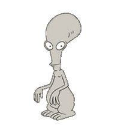
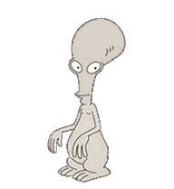
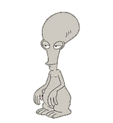

# Roger

A tiny, judgmental alien from *American Dad!* as an animated desktop companion for ChatGPT and Codex. Roger blinks, waves, jumps, thinks through a task, and has a facepalm for when it goes sideways.

| Idle | Wave | Facepalm |
| --- | --- | --- |
|  |  |  |

[All animations](previews/all-states.gif) · [Look directions](previews/look-directions.png) · [Sprite sheet map](docs/atlas.md) · [Build notes](docs/build-notes.md)

## Install

| Where you want Roger | What you need |
| --- | --- |
| ChatGPT desktop | The [roger folder](roger) with `pet.json` and `spritesheet.webp`. This is the full v2 pet with nine animation states and 16 look directions. |
| ChatGPT on the web | [roger-web-v1.png](web/roger-web-v1.png). This version keeps the nine standard animation rows and fits the documented web uploader. |
| Codex CLI | The desktop package. On a supported terminal, open `/pets` and select Roger. |

### ChatGPT desktop

Download this repository with **Code → Download ZIP**, extract it, and open a terminal in the extracted repository. Copy the `roger` folder into your Codex `pets` folder. The commands below leave any existing Roger installation in place and print its path.

**macOS or a Unix shell**

```sh
pet_root="${CODEX_HOME:-$HOME/.codex}/pets"
if [ -e "$pet_root/roger" ]; then
  printf 'Roger already exists at %s\n' "$pet_root/roger"
else
  mkdir -p "$pet_root" && cp -R ./roger "$pet_root/"
fi
```

**Windows PowerShell**

```powershell
$codexRoot = if ($env:CODEX_HOME) { $env:CODEX_HOME } else { Join-Path $HOME '.codex' }
$petRoot = Join-Path $codexRoot 'pets'
$target = Join-Path $petRoot 'roger'
if (Test-Path $target) {
  Write-Host "Roger already exists at $target"
} else {
  New-Item -ItemType Directory -Force -Path $petRoot | Out-Null
  Copy-Item -Path .\roger -Destination $petRoot -Recurse
}
```

In ChatGPT desktop, go to **Settings → Pets**, click **Refresh**, then select **Roger**. Type `/pet` in a chat to show the floating companion. If you’re updating an earlier copy, back up its folder and replace both `pet.json` and `spritesheet.webp` together before refreshing. Use **Settings → Pets → Customize → Pet size** to adjust the desktop display size. [ChatGPT Pets documentation](https://learn.chatgpt.com/docs/pets)

### ChatGPT web

Open [roger-web-v1.png](web/roger-web-v1.png) and download the original file. In ChatGPT, go to **Settings → Personalization → Pet** and choose **Upload pet** if it’s available for your account and workspace. Upload the PNG and give it the name **Roger**. The web pet appears inside supported Work chats. Desktop installs and web uploads use separate copies. [ChatGPT Pets documentation](https://learn.chatgpt.com/docs/pets)

## What’s in the package

- The desktop atlas packs **57 animation frames and 16 directional poses** into a transparent **1536 × 2288** WebP. Each frame is **192 × 208**.
- The web atlas has **57 animation frames** in a transparent **1536 × 1872** PNG.
- The latest art has a larger silhouette and a cleaner outline. See the [size comparison](previews/size-comparison.png), [edge comparison](previews/edge-comparison.png), and [change history](CHANGELOG.md).

## Validation

Both atlases passed the ChatGPT Pets sprite-sheet validator — see [docs/validation.json](docs/validation.json).

| Package | File | Size | Grid | Result |
| --- | --- | --- | --- | --- |
| Desktop v2 | `roger/spritesheet.webp` | 1536 × 2288 | 8 × 11, 192 × 208 cells, 73 poses | Valid, no errors |
| Web v1 | `web/roger-web-v1.png` | 1536 × 1872 | 8 × 9, 192 × 208 cells, 57 frames | Valid, no errors |

## Credits

Roger is a character from *American Dad!*. This is an unofficial fan project. The sprite adaptation was made by Em with ChatGPT-assisted artwork and animation cleanup. The character and show belong to their respective rights holders. See [NOTICE.md](NOTICE.md). [Character reference](https://press.wbd.com/us/media-release/tbs-0/tbs-announces-season-premiere-american-dad)
